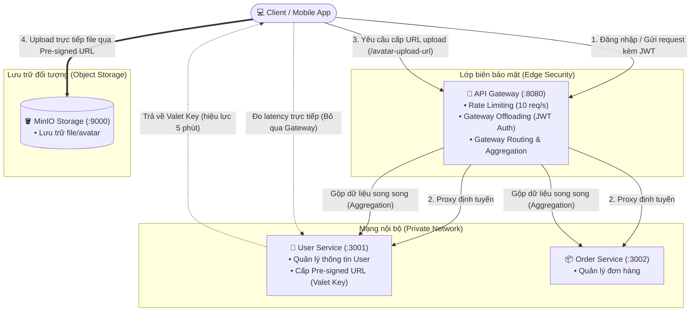

# 🛡️ Thiết Kế Cho Bảo Mật (API Gateway & Valet Key Patterns)

Dự án thực hành xây dựng hệ sinh thái Microservices áp dụng các mẫu thiết kế kiến trúc bảo mật tiêu chuẩn, bao gồm **API Gateway** làm lá chắn biên, hai dịch vụ nội bộ (**User Service**, **Order Service**) và lưu trữ đối tượng **MinIO Storage**.

---

## 🏛️ Kiến Trúc Hệ Thống & Luồng Dữ Liệu



---

## 🚀 1. Khởi Chạy Hệ Thống

### Lệnh khởi chạy
```bash
docker compose up --build -d
```

### Danh sách dịch vụ & Cổng truy cập

| Dịch vụ | Cổng (Port) | Địa chỉ | Vai trò & Trách nhiệm |
| :--- | :---: | :--- | :--- |
| **API Gateway** | `8080` | `http://localhost:8080` | Cửa ngõ duy nhất: Kiểm tra Rate Limit, xác thực JWT, định tuyến & gộp dữ liệu |
| **User Service** | `3001` | `http://localhost:3001` | Quản lý thông tin User, tạo Valet Key *(mở cổng để đo benchmark)* |
| **Order Service** | `3002` | `http://localhost:3002` | Quản lý danh sách đơn hàng |
| **MinIO Storage** | `9000` | `http://localhost:9000` | Lưu trữ đối tượng S3/MinIO nhận upload avatar |

---

## 🧪 2. Các Mẫu Thiết Kế Bảo Mật Đã Triển Khai & Cách Test

### Bước 0: Lấy JWT Token để test
Trước khi gọi các API được bảo vệ, thực hiện đăng nhập để lấy JWT Token:

```bash
curl -X POST http://localhost:8080/login
```

*Phản hồi mẫu:*
```json
{
  "token": "eyJhbGciOiJIUzI1NiIsInR5cCI6IkpXVCJ9..."
}
```

> [!TIP]
> Sao chép giá trị chuỗi `token` nhận được để gắn vào header: `Authorization: Bearer <TOKEN>` cho các bước bên dưới.

---

### 2.1. Gateway Offloading (Xác thực JWT & Rate Limiting)
- **Xác thực tập trung (Offloading)**: API Gateway chịu trách nhiệm kiểm tra tính hợp lệ của JWT token trước khi chuyển tiếp yêu cầu vào hệ thống nội bộ. Các service con không cần xử lý xác thực lặp lại.
- **Giới hạn lưu lượng (Rate Limiting)**: Giới hạn tối đa **10 request/giây** trên mỗi địa chỉ IP (vượt ngưỡng sẽ nhận phản hồi `429 Too Many Requests`).

```bash
# Thử nghiệm gọi không có token (bị từ chối: 401 Missing Authorization Header)
curl http://localhost:8080/users/1

# Thử nghiệm gọi kèm token hợp lệ (thành công)
curl -H "Authorization: Bearer <TOKEN>" http://localhost:8080/users/1
```

---

### 2.2. Gateway Routing (Định Tuyến)
Gateway hoạt động như một Reverse Proxy, định tuyến các path `/users` và `/orders` đến đúng microservice phụ trách:

```bash
# Định tuyến đến User Service
curl -H "Authorization: Bearer <TOKEN>" http://localhost:8080/users/1

# Định tuyến đến Order Service
curl -H "Authorization: Bearer <TOKEN>" http://localhost:8080/orders
```

---

### 2.3. Gateway Aggregation (Gộp Dữ Liệu)
Endpoint `/dashboard/:userId` trên Gateway gọi song song (`Promise.all`) sang cả `user-service` và `order-service`, sau đó gộp kết quả trả về trong một response duy nhất, giảm số lượng kết nối mạng giữa Client và hệ thống.

```bash
curl -H "Authorization: Bearer <TOKEN>" http://localhost:8080/dashboard/1
```

*Phản hồi mẫu:*
```json
{
  "user": {
    "id": 1,
    "name": "Nguyen Van A",
    "email": "vana@example.com"
  },
  "orders": [
    { "id": 101, "userId": 1, "product": "Laptop", "amount": 1200 },
    { "id": 102, "userId": 1, "product": "Mouse", "amount": 25 }
  ]
}
```

---

### 2.4. Valet Key (Upload Trực Tiếp Lên Storage Bằng Pre-signed URL)
Mẫu thiết kế giúp giải phóng App Server khỏi việc truyền tải dữ liệu file nhị phân lớn, ngăn ngừa tình trạng nghẽn I/O và băng thông.

1. **Bước 1: Xin cấp Pre-signed URL (Valet Key)**
   Chỉ cấp quyền ghi cho một file xác định, tự động hết hạn sau **5 phút (300 giây)**:
   ```bash
   curl -X POST -H "Authorization: Bearer <TOKEN>" http://localhost:8080/users/1/avatar-upload-url
   ```
   *Phản hồi mẫu:*
   ```json
   {
     "message": "Valet Key generated (Valid for 5 minutes)",
     "uploadUrl": "http://localhost:9000/avatars/user-1-1792765003424.png?X-Amz-Algorithm=...",
     "expiresIn": "300 seconds"
   }
   ```

2. **Bước 2: Tải thẳng file lên MinIO bằng URL được cấp**
   Client truyền file trực tiếp lên Storage mà không đi qua Gateway hay User Service:
   ```bash
   curl -X PUT -T "avatar.png" "<UPLOAD_URL>"
   ```
   *Kết quả phản hồi từ MinIO Storage:*
   ```json
   {
     "status": "Upload successful to MinIO Storage via Valet Key",
     "file": "/avatars/user-1-1792765003424.png",
     "validForSeconds": 300
   }
   ```

---

## 📊 3. Đo Lường Hiệu Năng & Độ Trễ (Latency Benchmark)

So sánh chi phí trễ khi đi qua lớp bảo vệ tập trung (API Gateway) so với việc gọi thẳng vào service nội bộ.

### Chạy script kiểm thử tự động
```bash
node benchmark.js
```

### Kết quả đo thực nghiệm (Terminal Output)
```text
--- ĐO ĐỘ TRỄ (LATENCY BENCHMARK) ---
Gọi thẳng User Service (Port 3001) trung bình: 3.25 ms
Gọi qua API Gateway   (Port 8080) trung bình: 13.86 ms
Độ trễ tăng thêm do Gateway (Xác thực JWT + Proxy): 10.62 ms
```

### Bảng phân tích chi tiết (Trung bình sau 5 lượt gọi)

| Phương thức gọi | Độ trễ trung bình | Cơ chế xử lý | Đánh giá |
| :--- | :---: | :--- | :--- |
| **Gọi thẳng `user-service` (`:3001`)** | **`3.25 ms`** | Kết nối trực tiếp container, không qua lớp bảo mật | Nhanh nhất nhưng để lộ cấu trúc nội bộ, không có kiểm soát truy cập |
| **Đi qua `api-gateway` (`:8080`)** | **`13.86 ms`** | Rate Limiting ➔ Giải mã & Kiểm tra chữ ký JWT ➔ Proxy chuyển tiếp | Toàn diện về an toàn, quản lý tập trung |
| **Độ trễ tăng thêm (Overhead)** | **`10.62 ms`** | Chi phí xác thực bảo mật và thêm một hop mạng trung gian | Hoàn toàn nằm trong ngưỡng tối ưu cho hệ thống phân tán |

### 💡 Nhận Xét & Đánh Giá Đánh Đổi (Security vs Performance Trade-off)
- **Về chi phí hiệu năng**: Khi đi qua API Gateway, độ trễ tăng thêm khoảng **~10.62 ms**. Đây là chi phí cần thiết để Gateway thực thi kiểm tra giới hạn tần suất (Rate Limiter), xác thực chữ ký mật mã token JWT và định tuyến gói tin (Proxy).
- **Về giá trị bảo mật & kiến trúc**:
  1. **Che giấu kiến trúc nội bộ (Attack Surface Reduction)**: Các microservice không cần mở cổng ra internet, ngăn chặn rủi ro tấn công trực tiếp.
  2. **Tách biệt mối quan tâm (Separation of Concerns)**: Các service nghiệp vụ tập trung vào logic kinh doanh, không phải cài đặt hay bảo trì lặp đi lặp lại phần code xác thực, bảo mật và rate limiting.
  3. **Tối ưu tài nguyên với Valet Key**: Đẩy tải luồng dữ liệu file lớn trực tiếp cho Storage server chuyên dụng, giữ cho API Gateway và các Backend Service luôn nhẹ và có độ phản hồi cao.
